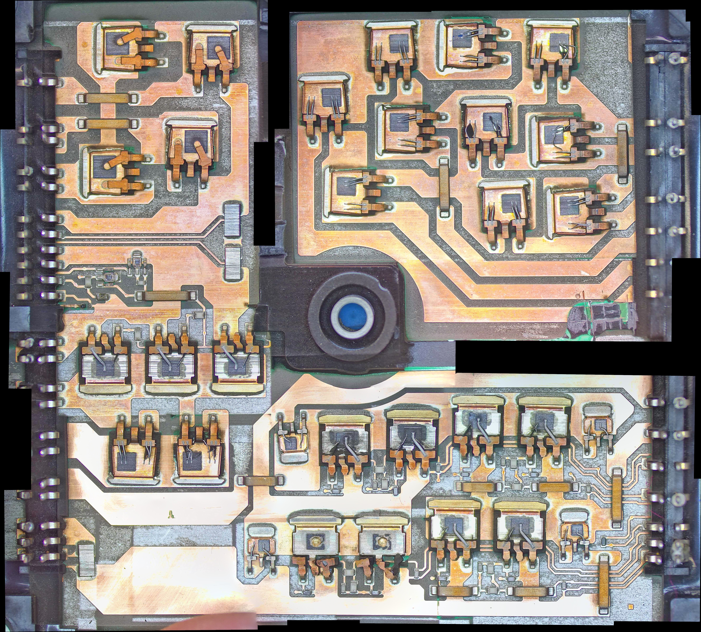

# LeafOBC-WafflePlate

Reverse engineering the "waffle plate" power module from the **2012 Nissan Leaf on-board charger (OBC)**, with the goal of building a **functional replica from regular, off-the-shelf components**.

The original module is a hybrid power assembly. It is a single-sided copper circuit on a ceramic substrate, bonded to an aluminium base plate, and mounted in a moulded frame. When one fails, the charger is usually written off. A drop-in replacement made from discrete, readily available parts would let these chargers be repaired.

<p align="center">
  <a href="images/stitched/waffle-plate-top.jpg"></a>
  <br>
  <em>Top side of the waffle plate. The potting and each component's encapsulation have been removed by laser etching, exposing the bare dies, bond wires and copper tracks. Stitched from 21 microscope images (5320 × 4802 px). Click for full resolution, or see the <a href="images/annotated/component-map.jpg">annotated component map</a>.</em>
</p>

> ⚠️ **High voltage.** The OBC works from mains AC and charges a traction battery of several hundred volts DC. Capacitors in the charger can hold a lethal charge after it is disconnected. Anything in this repo is provided for documentation and research, with no warranty. See the licence.

## Status

| Stage | State |
|---|---|
| Imaging | ✅ Stitched (21 tiles, ~5300 × 4800 px). The bottom is a plain aluminium plate, so it isn't imaged |
| Connector pinout | ⬜ Not started |
| Component identification | 🟡 Main semiconductors and shunts located ([map](images/annotated/component-map.jpg)) |
| Circuit topology / schematic | 🟡 KiCad schematic: input bridge, shunt and output rectifier verified; PFC wired; full bridge first pass ([notes](docs/schematic-notes.md)) |
| Replica design | 🟡 Altium design by Angel Monera Martinez, built but untested ([hardware/replica-altium](hardware/replica-altium/)) |
| Bench test | ⬜ Not started |

## Repository layout

```
docs/              Notes, findings, component inventory, imaging method
images/raw/        Original microscope tiles, one folder per capture set
images/stitched/   Stitched mosaics
hardware/
  original-module/ KiCad schematic of the original module (reverse-engineered)
  replica-altium/  Altium replica design by Angel Monera Martinez, with fabrication outputs
tools/stitch/      Script that stitches microscope tiles into a mosaic
```

## Documents

- [Overview and open questions](docs/overview.md)
- [Schematic notes and verification checklist](docs/schematic-notes.md)
- [PFC gate driver: original pin-out and replica wiring error](docs/pfc-gate-driver.md)
- [Primary full bridge: gate network (work in progress)](docs/full-bridge-gate-drive.md)
- [Component inventory](docs/component-inventory.md)
- [Imaging and stitching method](docs/imaging.md)
- [Altium replica build log (Angel Monera Martinez)](docs/replica-altium-notes.md)
- [External references](docs/references.md): the Ukrainian schematic (module CZ1525RPWR012) and forum threads

## Contributors

- **Ray (Mozzie-AU)**: reverse engineering, imaging, meter verification, repository
- **Angel Monera Martinez**: Altium replica design and build log ([hardware/replica-altium](hardware/replica-altium/)), contributed with permission

## Contributing

Information from anyone who has worked on Leaf (ZE0) chargers is very welcome. This includes failure modes, part markings, service documents and photos. Please open an issue or pull request.

## Licence

Hardware designs and documentation are released under the **CERN Open Hardware Licence v2 – Strongly Reciprocal** ([CERN-OHL-S-2.0](LICENSE)).

The Altium replica design in `hardware/replica-altium/` and its build log are the work of Angel Monera Martinez, included with his permission.

Nissan and Leaf are trademarks of Nissan Motor Co., Ltd. This project is independent and is not affiliated with or endorsed by Nissan.
