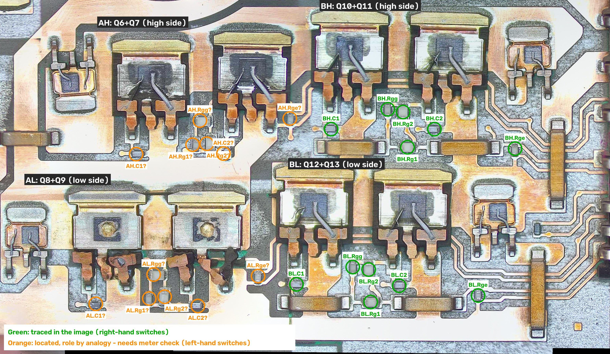

# Primary full bridge: gate network

Work in progress on the gate-drive network around the eight full-bridge IGBTs (section C of the schematic). Everything here comes from **copper traced in the stitched image** of the laser-stripped module. On that module every semiconductor is shorted, resistors are open and the capacitors are degraded. So:

- **Connections** can be confirmed with a meter, but only between copper points that no part bridges.
- **Part values and types** can't be measured on this module. They are listed from references until a second unit is available.



*Crop of [`images/stitched/waffle-plate-top.jpg`](../images/stitched/waffle-plate-top.jpg), x 1850–4950, y 2950–4750. Green circles are parts whose connections were traced in the image. Orange circles are parts located but assigned by analogy, so they need a meter check.*

## Switches and legs

Read from where the IGBT tabs (collectors) and emitter leads sit on the copper:

| Switch | IGBTs | Collector (tab) on | Emitter on | Freewheel diode |
|---|---|---|---|---|
| **AH**: leg A high side | Q6, Q7 (top-left) | top HV_BUS+ copper | leg A midpoint (large cream area, left) | D7 |
| **AL**: leg A low side | Q8, Q9 (bottom-left) | leg A midpoint | bottom rail (HB_N) | D8 |
| **BH**: leg B high side | Q10, Q11 (top-right) | top HV_BUS+ copper | leg B midpoint (vertical copper column) | D9 |
| **BL**: leg B low side | Q12, Q13 (bottom-right) | leg B midpoint | bottom rail (HB_N) | D10 |

This matches the provisional assignment already in the schematic.

On each IGBT, the **left** lead has the thin bond wire (**gate**). The **right** lead has the thick bond wire (**emitter**). The middle lead is trimmed, because the collector is the tab.

The freewheel diodes have bond wires to **both** outer leads, so both outer leads are the anode, and the tab is the cathode.

## Gate network per switch

The two right-hand switches (BH, BL) have identical copper layouts, one shifted about 800 px below the other. Both were traced in full. Each has six small parts:

| Part | Connects | Role | Ukrainian schematic | Reference value |
|---|---|---|---|---|
| **Rg1** | drive input ↔ gate of IGBT 1 (via the left jumper) | gate resistor | R210 | 10 Ω |
| **Rg2** | drive input ↔ gate of IGBT 2 | gate resistor | R212 | 10 Ω |
| **Rgg** | gate 1 ↔ gate 2 | resistor between the two gates | R211 | 10 Ω |
| **C1** | gate 1 ↔ emitter (beside the gate lead) | gate–emitter capacitor | C210 | 1 nF |
| **C2** | gate 2 ↔ emitter | gate–emitter capacitor | C211 | 1 nF |
| **Rge** | drive input ↔ emitter rail; a second track from the same end runs to the module pins | drive-input pull-down; emitter (Kelvin) return | R213 | 1 kΩ |

```
 drive in (pad) ──┬──[Rg1]──┬── gate IGBT1 ──[C1]── emitter
                  │       [Rgg]
                  ├──[Rg2]──┴── gate IGBT2 ──[C2]── emitter
                  └──[Rge]────────────────────────── emitter ──→ Kelvin return (pad)
```

This reproduces the Ukrainian schematic exactly, including its unusual 10 Ω between the gates. That's now confirmed by the copper, not just the drawing.

The roles of C1/C2 versus Rge come from where they connect. On this module the parts can't tell us whether a given chip is a resistor or a capacitor. The values in the table are the Ukrainian schematic's and are **unconfirmed**.

### Layout notes

- The gate-drive input and the far-side gate cross the big copper (the midpoint column, or the emitter copper) on the **horizontal copper jumpers** at y ≈ 3700 (BH) and y ≈ 4490 (BL).
- The drive-input and Kelvin-return tracks run right, **under the vertical jumpers** at x ≈ 4570–4650, to the module pins on the right edge.
- Each gate node has a small round test pad: BH at (3445, 3600) and (3977, 3606); BL at the corresponding spots.

## Part positions

Pixel positions in the stitched image.

| Switch | Rg1 | Rg2 | Rgg | C1 | C2 | Rge |
|---|---|---|---|---|---|---|
| BH (traced) | (3920, 3698) | (3898, 3519) | (3820, 3505) | (3532, 3606) | (4057, 3606) | (4467, 3705) |
| BL (traced) | (3733, 4485) | (3723, 4320) | (3642, 4307) | (3356, 4395) | (3878, 4402) | (4279, 4452) |
| AH (by analogy) | (2828, 3685)? | (2900, 3680)? | (2865, 3562)? | (2541, 3733)? | (2985, 3730)? | (3322, 3552)? |
| AL (by analogy) | (2608, 4467)? | (2686, 4458)? | (2630, 4345)? | (2336, 4494)? | (2855, 4505)? | (3161, 4353)? |

For the left-hand switches, what the image does show:

- **AH:** C1 sits beside Q6's gate lead and C2 beside Q7's. The two "Rg" parts share a bottom track (the drive input), and Rgg joins their tops.
- **AL:** the parts sit in the same pattern.

Which gate each Rg feeds hasn't been traced yet.

## Damage

The low-side switch of leg A (**AL**: Q8, Q9) has burnt and partly melted leads and copper around the gate and emitter area. There is green residue next to Q9. The two dies also look different from the other six (a round spot in the middle). This is probably where the module failed.

## Meter checks (copper only)

Probe copper on both sides, never across a part.

1. **BH and BL:** gate test pad ↔ gate lead pad, for each IGBT, to confirm the gate nets.
2. **BH and BL:** each end of the horizontal jumpers ↔ the tracks they join (left end to gate 1, right end to the drive input).
3. **Pad mapping:** from each Rge's drive-input end and its Kelvin track, follow to the module pins. That gives the four drive/return pairs (pads 21/22, 23/24, 19/20, 25/26 on the Ukrainian schematic) for each switch.
4. **AH and AL:** for each part, check each end against the gate pads, the emitter copper and the shared drive-input track, to confirm or correct the roles marked "?".
5. **Midpoints:** leg A midpoint (cream area) ↔ pad p23 (T1); leg B midpoint (vertical column) ↔ pad p25 (T4). Or the other way round, which is the point of checking.

## Still needed

- A second, intact module to measure the part values and confirm the part types.
- The pad mapping (check 3).
- Confirmation of the left-hand switches (check 4).
- Then the gate networks can go into section C of the schematic.
