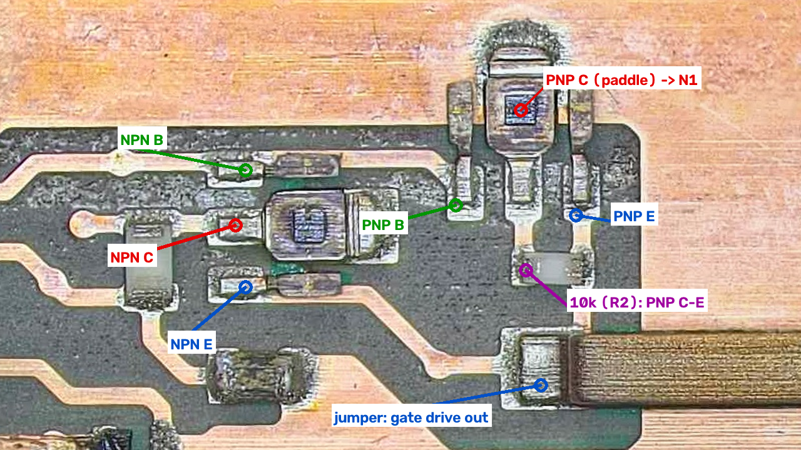

# PFC gate driver

The three PFC IGBTs (Q1–Q3) are driven by a complementary emitter-follower (push-pull) stage made of two small SOT-89 transistors. This page records how that stage is wired on the **original module**, and a wiring error found in the replica designs.



*Crop from [`images/stitched/waffle-plate-top.jpg`](../images/stitched/waffle-plate-top.jpg), around x 520–1320, y 1880–2330 (upper-left quadrant). The transistor packages have been laser-stripped, so only the lead frames and dies are left.*

## How the pins were identified

1. **Collector.** On a SOT-89 the middle lead is one piece with the die paddle, which is the collector. That's visible on both dies.
2. **Base.** One trace runs from a lead of the centre transistor to a lead of the top-right transistor. In a push-pull stage the bases are tied together and driven by the PWM input, so this trace is the base net.
3. **Emitter.** The remaining lead of each transistor. Both emitters run to the left pad of the long copper jumper. The jumper carries the gate drive over the N1 copper to the PFC gate resistors.
4. **NPN or PNP.** The top-right transistor's collector paddle sits on the large N1 copper, the IGBT emitter return, so it is the **PNP**. The centre transistor's collector goes toward the driver supply (via the 43 Ω resistor), so it is the **NPN**.
5. **10 k resistor.** The small resistor below the top-right transistor connects its collector (N1) to its emitter (the output). It's the gate pull-down, R2 in the replica design.

## Original module wiring

| Transistor | Collector | Base | Emitter |
|---|---|---|---|
| NPN (centre die), BCX56-16 type | driver supply (via 43 Ω, decoupled by 1 µF) | PWM input | gate drive out |
| PNP (top-right die), BCX53-16 type | N1 (IGBT emitter return) | PWM input | gate drive out |

```
 Driver supply ─[43 Ω]─┬──── C  NPN
                    1 µF        B ──┐
                       │        E ──┼──── gate drive out → jumper → PFC gate resistors (R1–R3)
 N1 ───────────────────┘        E ──┤          │
                                B ──┘        10 k (pull-down to N1)
 N1 ──────────────────────────── C  PNP
                     PWM in ──── both bases
```

This is the standard complementary emitter follower:

- **Non-inverting:** PWM high gives gate high.
- **Current gain:** the PWM source only supplies base current.
- **No shoot-through:** the two base–emitter junctions face each other, so only one transistor can conduct at a time.
- **No saturation:** neither transistor saturates, so it switches fast.

**Status: verified.** First read from the image, then confirmed with the meter by Ray:

1. Both emitters (the NPN bottom lead and the PNP right leg) have continuity to the jumper's left pad.
2. The PNP collector paddle has continuity to the N1 pads (J18/J19).
3. The NPN collector has continuity to the 43 Ω resistor and driver supply.

## Error in the replica designs

Angel Monera Martinez's replica ([`hardware/replica-altium/`](../hardware/replica-altium/)) and the Ukrainian schematic ([references](references.md)) both draw the driver with **emitter and collector swapped on both transistors**. The replica PCB is wired that way too:

| Replica (Altium/KiCad) | Collector (pad 2) | Base (pad 1) | Emitter (pad 3) |
|---|---|---|---|
| Q2 BCX56-16 (NPN) | gate output | PWM input (J1 pin 19) | driver supply (via R3 43 Ω, C1) |
| Q1 BCX53-16 (PNP) | gate output | PWM input (J1 pin 19) | N1 |

With the emitters on the rails, neither transistor can work normally. The NPN would only turn on if its base rose above the supply, and the PNP only if its base fell below N1. What conducts instead is each transistor's base–collector junction, acting as a plain diode. The PWM source then drives the IGBT gates through those diodes with almost no current gain, so the gates charge slowly, if at all, and the PWM source is badly overloaded.

**Fix for the replica:** swap the collector and emitter nets on both SOT-89s, so both emitters (pad 3) go to the gate output, the NPN collector (pad 2) goes to the 43 Ω supply node, and the PNP collector (pad 2) goes to N1. The base tracks (pad 1) stay as they are.

## Our reverse-engineered schematic

Section B of [`hardware/original-module/waffle-plate.kicad_sch`](../hardware/original-module/waffle-plate.kicad_sch) now matches the verified wiring:

| Ref | Part | Connections |
|---|---|---|
| Q4 | NPN | collector VDRV_F, base PFC_PWM, emitter PFC_GDRV |
| Q5 | PNP | emitter PFC_GDRV, base PFC_PWM, collector PGND |
| R8 | 43 Ω | VDRV (supply pad) to VDRV_F |
| C4 | 1 µF | VDRV_F to PGND |
| R4 | 10 kΩ | PFC_GDRV to PGND (gate pull-down) |

These parts are marked `Verified = yes`. The module pad that supplies VDRV hasn't been assigned yet.
