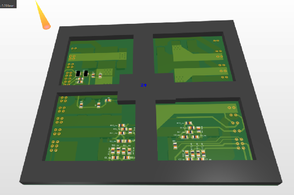
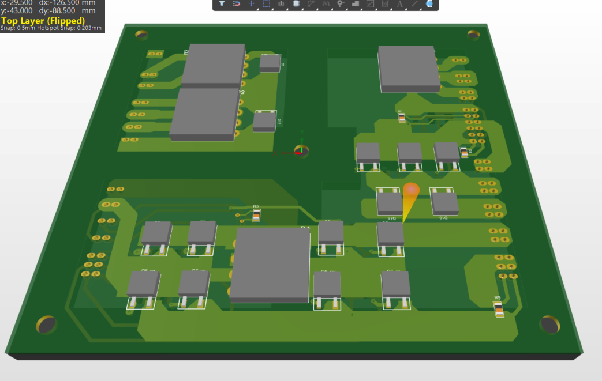
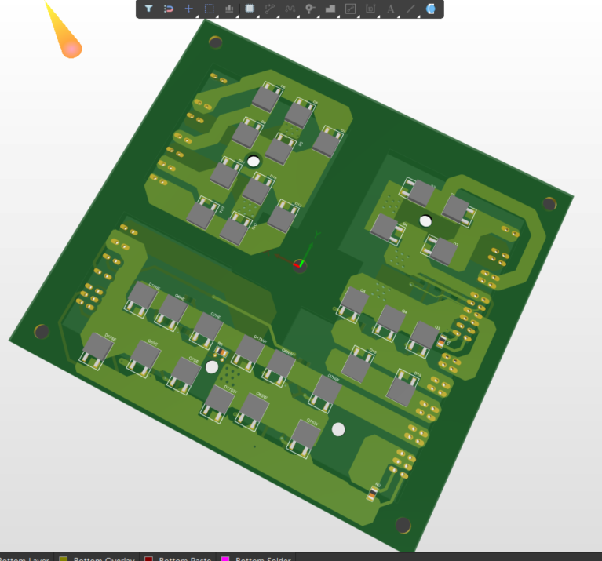
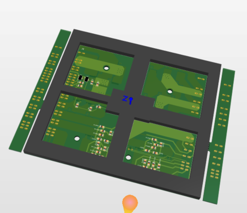
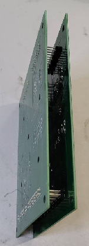
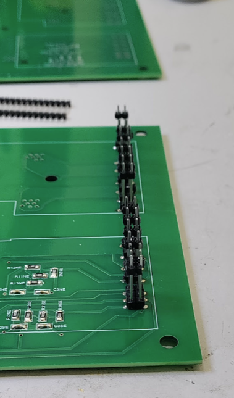
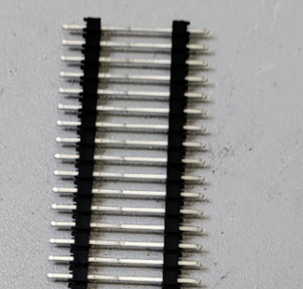

# Altium replica: build log

**Author:** Angel Monera Martinez. Imported with permission from his Google Doc *"Waffle plate Nissan Leaf – Project details and contact information"* (last edited 10 Jan 2025). The text is his, tidied for Markdown, with notes in *[square brackets]* where something was changed. The design files are in [`hardware/replica-altium/`](../hardware/replica-altium/).

> **Status (Jan 2025): untested.**

## Project details

- **Software:** Altium Designer 2024
- **PCB:** two layers

### Components chosen

- **IGBT:** [IGD08N120S7ATMA1](https://eu.mouser.com/ProductDetail/726-IGD08N120S7ATMA1) *[the BOM in the design files lists HGT1S10N120BNST instead; see the replica README]*
- **Diodes:** [STTH25M06B-TR](https://octopart.com/stth25m06b-tr-stmicroelectronics-111622376)
  - Possible cheaper replacement (to be done): [GBU3008](https://eu.mouser.com/ProductDetail/241-GBU3008_T0_00601)
- **BJT transistors:** [BCX53-16](https://eu.mouser.com/ProductDetail/637-BCX53-16), [BCX56-16](https://eu.mouser.com/ProductDetail/637-BCX56-16)
- **Thermal paste:** [Chip Quik TC2-10G](https://eu.mouser.com/ProductDetail/Chip-Quik/TC2-10G?qs=VVKQmw408U%252Bss7hgnb4sLg%3D%3D) (find something cheaper?)

Approximate component cost per waffle plate: €45 plus shipping.

## Log

### 2024-10-19

To make sure the board makes good contact with the metal plate underneath, I plan to laser-cut a polycarbonate frame (I have a laser cutter and some polycarbonate scraps). It screws on top of the PCB to spread the pressure evenly and stop the board bulging while it is screwed down. (**Mechanical layer 20**)

**To do:**

- ~~Find thermal conductive material and a ~2 mm aluminium plate to clamp all the transistors and diodes together.~~ (Maybe not needed. It may be better to clamp it to the cooling plate in the box.)
- ~~Find connectors or single-core cable to make pins (1.2 mm²?)~~

Cable: 18 AWG / 17 AWG, or 1 mm² max (1 mm² = 1.13 mm diameter, holes are 1.2 mm).

- [Alpha Wire 296-SV005 bus wire, 18 AWG](https://uk.farnell.com/alpha-wire/296-sv005/wire-bus-bar-18awg-30-5m/dp/1302720)
- [Diameter to cross-section calculator](https://ohmslaw.eu/diameter_cross_section/1.2-mm_-mm2-_AWG)

### 2024-10-22

Updated the design with bridge rectifiers instead of 16 diodes.

It's cheaper: the parts basket went down to €31 plus shipping. However, I think the rectifier bridges are a bit taller than the other diodes and transistors, so they would stand above the other parts. The other transistors would then need shims to equalise contact with the cooling plate. That may add material cost to get the heat from the transistors into the plate. It may be possible to sand the rectifiers down to the height of the other parts.

*It may be better to work with the previous version.*

### 2024-10-24

Corrected the footprints of the diodes I ordered. I could use this version, but I would need to shim all the transistors to match the height of the diodes, and that can lead to problems. It's better to correct the design than to continue with this one, and order new diodes.

### 2024-10-25

Corrected the design to use diodes in TO-252-3, as that footprint was wrong. I believe this design is ready for production. All parts should be the same height.

To improve contact with the cooling plate on the OBC, I would ideally recommend a few of these:

- [Panasonic EYG-S0305ZLSM thermal interface material](https://uk.farnell.com/panasonic/eygs0305zlsm/thermal-interface-material-27x51mm/dp/2723050)
- [ILA TIM cluster graphite pad 25 × 25](https://uk.farnell.com/intelligent-led-solutions/ila-tim-cluster-25x25-1a/heat-sink-pad-graphite-sheet-240w/dp/3790359)
- [ILA TIM LEDiL graphite pads](https://uk.farnell.com/intelligent-led-solutions/ila-tim-ledil-1a/heat-sink-pads-graphite-sheet/dp/3702709)

### 2024-10-27 (from the 25th version)

Changed the rules a little, adjusted the polygons and moved some resistors. Sent to JLCPCB: 5 boards for US$60 including shipping, with 2 oz copper.

*[This is the version in the first replica commit, with its fabrication outputs in `fabrication/2024-10-28-jlcpcb/`.]*

### 2024-11 (date not recorded)

Enlarged the IGBT and diode pads, as they were a bit too tight for the parts and the parts wanted to sit off them. *[23 Nov 2024 version.]*

### 2024-12-05: I think this is the final version

During assembly I found that if you use single or double pins, the top of the wires needs support. I added support PCBs with breakout tabs, which are snapped off the main PCB and used to hold the pins while they are soldered. *[4 Dec 2024 version.]*

The pins I used for the waffle: cut the pins in pairs and fit them into the support PCB, then push them into the main PCB. If the support gives you trouble, cut it in two to make it more flexible. I didn't have the support boards, so I used another of the PCBs I'd made. It took a few minutes to align everything, but it was much easier with these pins than with the rigid wires I tried before, which I still couldn't align properly after four hours.

Once they are aligned, solder the pins (on the right-hand PCB) and store it like that until the final assembly into the charger.

After soldering, remove the support PCBs and then put them back. That shows how hard it will be to fit it back into the main charger board.

Pins used: I found them in a drawer, so I don't know the part number, but [Samtec DW-05-09-L-S-510](https://eu.mouser.com/ProductDetail/Samtec/DW-05-09-L-S-510?qs=Cqqh%252BS766wlkK2y9hIwhOg%3D%3D) should work the same way.

### 2024-12-20: preparing for final assembly

Remember that more parts could be damaged: mainly the parts under resin, of course, and the big diode beside the capacitors where the big capacitor connects.

Replace the HV capacitors. We are already in there and have spent a lot of time on this, so at least make sure they are working. Also check the power resistors, coils and diodes, and verify or replace them as you see fit.

### 2025-01-09: final assembly

Assembling the board showed a few more problems with my design:

- The pins on one side need to be slightly further left (1.5 mm wider).
- The main holes, which I thought were square, are not.

I have updated the design to line up the pins and holes, including a wider diameter to fit the screws better. *[These January 2025 changes are not in the shared files: the latest design in the share is 4 Dec 2024.]*

During assembly I also realised that to see properly how the transistors touch the plate, it would be better to fit a copper or aluminium plate, so you can check the transistor contact before installing that block in the charger box. Right now I have no idea whether all the transistors are touching. I added some thermal silicone to improve contact, but I won't know until I plug in the charger and let it run for a while.

So, add a plate (maybe 5 mm thick), then the 3D-printed bracket, then some screws in the plate. Tap the plate so it screws down and fixes in place before anything else. (The bracket designed above will help, but I've only just got a 3D printer and haven't managed to make it yet, and I can't wait to have the car ready.)

Once it's fixed, try fitting the main board on top, screw it down, then solder. If you have trouble:

1. With the 5 mm plate attached to the waffle plate, solder only the corner pins, with barely any header sticking out (longer reach).
2. Put it in the box and fit the 5 screws on the waffle plate.
3. Melt the solder on the corners while pressing each one in turn until the main board is fully seated.
4. Once the board is seated, solder all the pins, then reconnect everything.

The PCB has notes on cable colours and markings in case the photos leave any doubt.

Then close it up, connect the coolant hoses, pray, connect, pray some more… and…

## Manufacturing

- Europe: Eurocircuits
- China: PCBWay, JLCPCB (cheapest)

All of these also offer to buy and solder the parts for you. They won't solder the pins, of course, but the result will be much better than hand soldering.

Before you replace your waffle plate, make sure you have repaired anything else that is damaged on the main PCB. Check:

- capacitors
- resistors
- diodes
- coils

## Photos of the connections

Reference photos of the charger wiring are in this forum thread: <https://mynissanleaf.com/threads/onboard-charger-capacitors-failed.28009/page-4>

*[Angel's notes included three of those forum photos. They aren't his, so they are linked rather than copied here.]*

## Contact

Angel is a collaborator on this repository. Please contact him through GitHub (issues, pull requests or mentions). *[His personal contact details are left out of this public repo.]*
