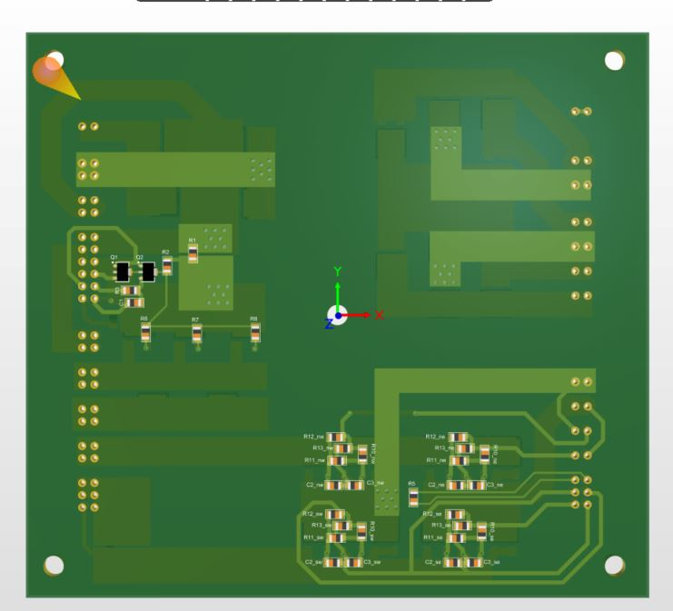
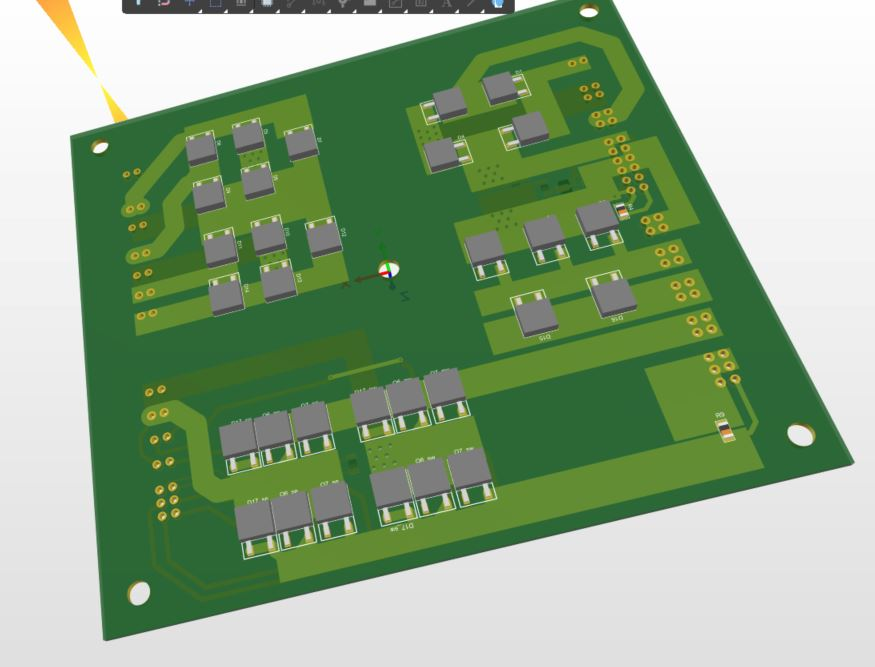

# Altium replica design (Angel Monera Martinez)

A drop-in replacement for the waffle plate built from off-the-shelf packaged parts on a two-layer PCB. **Designed by Angel Monera Martinez** and included here with his permission. His build log is in [`docs/replica-altium-notes.md`](../../docs/replica-altium-notes.md).

> **Status: untested.** Angel assembled a board into a charger in January 2025, but it had not been run when these files were shared.

The power semiconductors sit on the underside, against the charger's cooling plate. The gate drive and other small parts are on the top.

## Contents

| Path | What |
|---|---|
| `altium/Nissan Leaf Waffle.PrjPcb` | Altium project |
| `altium/waffle.SchDoc` | Main schematic |
| `altium/igbt pair.SchDoc` | Sub-sheet: one switch (IGBT pair plus gate network), repeated four times for the full bridge (designators suffixed NE/NW/SE/SW) |
| `altium/waffle.PcbDoc`, `altium/waffle.PcbLib` | PCB and footprint library |
| `altium/Nissan Leaf Waffle.SCHLIB` | Schematic symbol library |
| `altium/waffer.OutJob` | Output job used to produce the fabrication files |
| `fabrication/2024-10-28-jlcpcb/` | Gerbers, NC drill, BOM, pick and place, DRC and stack-up reports **for the 27 Oct 2024 version** (the one sent to JLCPCB) |
| `kicad/` | **KiCad conversion** of the 4 Dec version (schematic, PCB, symbol library, schematic PDF). See below |
| `renders/` | 3D renders of the board |

## Versions (git history)

| Date | Commit message | Change |
|---|---|---|
| 2024-10-27 | *Add Angel Monera Martinez's Altium replica design* | Version sent to JLCPCB, with fabrication outputs |
| 2024-11-23 | *Replica design: 23 Nov 2024 version* | Enlarged IGBT and diode pads (PCB only) |
| 2024-12-04 | *Replica design: 4 Dec 2024 version* | Adds snap-off support PCBs that hold the pins while soldering. Schematic and PCB updated. Current files |

Use `git log -- hardware/replica-altium/altium/waffle.PcbDoc` to step through them.

**Not included:** after the January 2025 test fit, Angel moved the pins on one side 1.5 mm outward and corrected the mounting holes, which are not square. That revision was not in the shared files. Ask Angel for it before ordering boards.

**The fabrication outputs are out of date.** They match the 27 Oct version, not the current files. Regenerate them from the OutJob before ordering.

## Bill of materials (from the 27 Oct fabrication BOM)

| Qty | Part | Designators | Function |
|---|---|---|---|
| 11 | HGT1S10N120BNST (BOM footprint: PG-TO252-3) | Q3–Q5, Q6/Q7 × NE/NW/SE/SW | PFC switches (3) and full bridge (8) |
| 20 | SE20DLJ-M3/I (BOM footprint: PG-TO252-3) | D1–D20 | Input bridge, boost, freewheel and output rectifier diodes |
| 1 | BCX53-16 (PNP, SOT-89) | Q1 | PFC gate driver |
| 1 | BCX56-16 (NPN, SOT-89) | Q2 | PFC gate driver |
| 2 | 1 mΩ 1206 | R1, R9 | Current shunts |
| 2 | 100 k NTC (NB20N50104JBA) | R4, R8 | Temperature sensing |
| 3 | 39 Ω | R5–R7 | PFC gate resistors |
| 12 | 10 Ω | R10–R12 × NE/NW/SE/SW | Full-bridge gate resistors |
| 4 | 1 kΩ | R13 × NE/NW/SE/SW | Gate–emitter resistors |
| 8 | 1 nF | C2, C3 × NE/NW/SE/SW | Gate capacitors |
| 1 | 10 kΩ | R2 | |
| 1 | 43 Ω | R3 | |
| 1 | 1 µF | C1 | |

Inconsistencies to check:

- Angel's notes name **IGD08N120S7** IGBTs and **STTH25M06B** diodes, but the BOM lists HGT1S10N120BNST and SE20DLJ-M3/I. Confirm with Angel which parts he actually fitted.
- The diode line's supplier part numbers (VS-E5TX3012S2L-M3) don't match the part named in the same line (SE20DLJ-M3/I).
- The IGBT line's description reads "IGBT N type 20A(40) 600V dpak, possible replacement STB27NM60N", which doesn't match the HGT1S10N120BNST part name.

## Opening the files

- **Altium Designer:** open `Nissan Leaf Waffle.PrjPcb` in `altium/`.
- **KiCad 7 or later:** open `kicad/waffle.kicad_pro`.

## KiCad version (`kicad/`)

The Altium files (4 Dec 2024 version) were converted with KiCad 7.0.11's own Altium importers:

- **Schematic:** *File → Import → Non-KiCad Schematic* on `waffle.SchDoc`, which pulls in the `igbt pair` sub-sheet.
- **PCB:** the same importer, run through KiCad's Python API on `waffle.PcbDoc`.

| File | What |
|---|---|
| `waffle.kicad_pro` | Project |
| `waffle.kicad_sch` | Main sheet |
| `igbt pair.kicad_sch` | Switch sub-sheet, used four times (NW, NE, SW, SE) |
| `waffle-altium-import.kicad_sym`, `sym-lib-table` | Symbols extracted from the Altium design |
| `waffle.kicad_pcb` | PCB (footprints are embedded in the board) |
| `ALTIUM_EMBEDDED_MODELS/` | 3D model carried over from the PcbDoc |
| `waffle-schematic.pdf` | PDF of the schematic |

**One fix was made after import.** Altium's multichannel naming (NE/NW/SE/SW suffixes on the four copies of the switch sheet) didn't survive the import. All four copies came in with identical names (Q6, R10 and so on), which in KiCad merges the four switches' gate nets into one. Each sheet copy was given its Altium channel name (`igbt pair NE` and so on), confirmed from the sheet-symbol records in the `.SchDoc`. Each part was given its per-channel reference (`Q6NE`, `R10SW` and so on), matching the PCB.

**Checks made on the conversion:**

- The schematic netlist and the PCB connectivity were compared pin by pin. All 219 pins the two have in common group into the same 42 nets, so the conversion didn't change any connectivity.
- The schematic has one extra part, **J2**, a second 72-pin edge-connector symbol with no footprint on the board. It came across from the Altium schematic as-is.
- The PCB has 312 footprints in total. Only 68 of them are named parts; the rest are the pins and the snap-off support boards.

**Known quirks:**

- KiCad warns about *annotation errors* when exporting. The only cause is the Altium-style names that end in letters (`Q6NE`). KiCad expects names to end in a number. It's cosmetic, and the names are kept so they match the PCB, the BOM and Angel's notes. **Don't run *Annotate Schematic*** unless you mean to rename these parts. If you do, update the PCB with *Tools → Update PCB from Schematic* and tick *Re-link footprints to schematic symbols based on their reference designators*.
- The schematic and PCB were imported separately, so the footprints are not yet linked to the symbols. The first *Update PCB from Schematic* should use the same re-link option.
- The PCB import gave 271 warnings. All of them say items on Altium mechanical layers 71 and 72, which have no KiCad equivalent, were moved to `Eco1_User`.
- The ERC and DRC rules have not been tuned for KiCad. Treat their first results as a to-do list, not as design errors.

## Relation to the reverse-engineered schematic

[`../original-module/`](../original-module/) is our schematic of the **original** module. Angel's netlist is an independent reading of the same circuit, so the two can be cross-checked. Any difference is worth a meter check on the original module.
